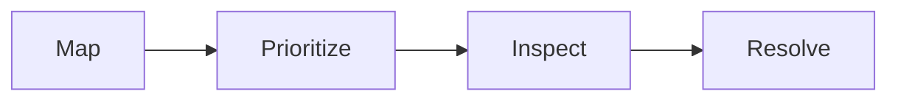

# DrainSentinel

A map-based storm-drain inspection workflow combining risk prioritization, maintenance tasks, and a traceable path to resolution.

**Status:** Hackathon prototype · Synthetic drain telemetry.

[Portfolio case study](https://debayan-cyberx.github.io/Deb-s-Portfolio.github.io/#project-drain)

## Problem and intended user

Help municipal inspection teams prioritize at-risk drains and track maintenance work through a visible operational workflow.

## My implementation

I implemented the frontend, mapping, backend services, risk and inspection workflows, and deployment code. Teammates contributed research and presentations.

## Stack and workflow

React, FastAPI, Leaflet, AWS adapters.



## Walkthrough

1. Inspect the drain map, risk levels, and the factors behind a prioritized asset.
2. Open a drain detail and review supporting reports and inspection context.
3. Create and progress a maintenance task through the inspection workflow.
4. Review resolution evidence and audit history rather than treating a risk score as a final operational decision.

## Run locally

Install Python and Node.js with npm, clone the repository, and run the backend from `backend`:

```sh
cd backend
python -m venv .venv
# Windows PowerShell: .\.venv\Scripts\Activate.ps1
# macOS/Linux: source .venv/bin/activate
python -m pip install -r requirements.txt
python -m uvicorn app.main:app --host 127.0.0.1 --port 8000
```

The default storage backend is in-memory; AWS credentials are not required for that mode. Optional AI and cloud services need their own configuration. See `backend/app/core/config.py` for the current setting names.

In a second terminal, from `frontend`:

```sh
npm ci
npm run dev
```

The frontend defaults to `http://127.0.0.1:8000`; set `VITE_API_URL` when using a different backend. Open the Vite URL. API health is exposed at `/api/health`, versioned routes at `/api/v1`, and OpenAPI documentation at `/docs`.

```sh
# From backend, with the virtual environment active
python -m pytest -q
# From frontend
npm run build
```

Cloud adapters and deployment scripts exist in the repository. [DEPLOYMENT_AWS.md](DEPLOYMENT_AWS.md) documents the intended AWS setup; infrastructure availability must be checked separately from a local run.

## Technical decision and tradeoff

Use explainable risk heuristics with an optional AI layer and local/cloud storage adapters. This supports a reproducible demo; real flood-risk use requires calibrated data and operational validation.

## Current limitations

The demonstration uses synthetic telemetry. Scores are not validated flood forecasts. Cloud services require configuration; infrastructure code does not imply every deployment is active.

## Validation scope

The repository includes risk-engine, API, weather/prediction, inspection-workflow, and AWS-adapter tests. Synthetic inputs demonstrate behavior rather than field accuracy. Validation commands are provided for reproduction; this documentation update does not claim new test runs or production measurements.

